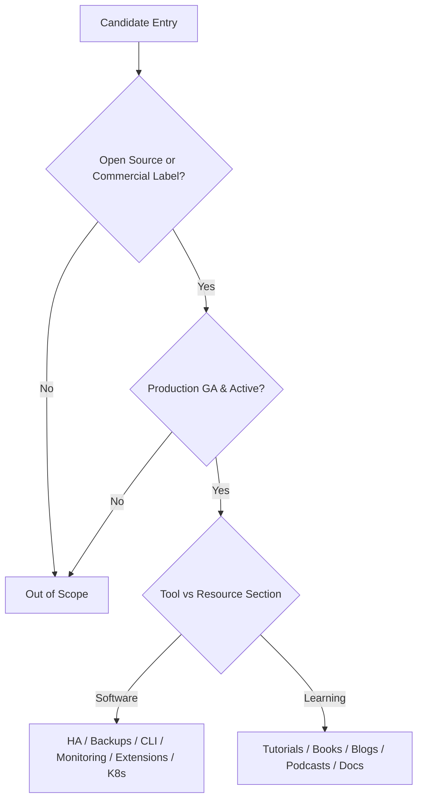

# Taxonomy, Curation Policy & Quality Gates

`awesome-postgres` maintains a single-page catalog (`312` curated entries across `27` sections) balancing breadth of tooling against strict entry quality rules.

## Curation & Taxonomy Flow

## Design Trade-Offs

### 1. Why Software Entries Require Production Maturity

- New experimental scripts frequently break or change licenses within months.
- Requiring production adoption and active maintenance keeps curated recommendations trustworthy for DBAs and application engineers.

### 2. Why Commercial Tools Must Carry Explicit Labels

- Many operators evaluate database tools under strict open-source procurement policies.
- Appending `(Commercial Software)` inline preserves discoverability for proprietary products (such as DataGrip or pgMustard) without misleading open-source adopters.

### 3. Why TOC Parity Matters as the List Grows

- With `400+` lines across `27` sections, omitted headings inside `## Contents` (previously `Security`, `Books`, and `Podcasts`) effectively hide valid curated tools from readers. Automated TOC parity checks keep navigation synchronized whenever categories expand.
