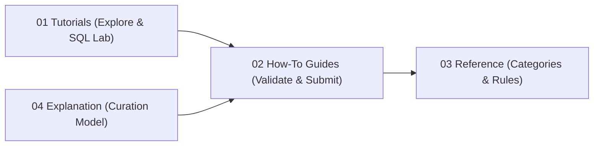

# Awesome Postgres Documentation

Structured Diátaxis documentation for navigating curated PostgreSQL resources, validating list formatting, submitting compliant entries, and practicing modern SQL patterns.

## Quadrants

| Quadrant | Focus | Entry Point |
| :--- | :--- | :--- |
| **Tutorials** | Repository navigation and SQL syntax lab | [Tutorials Index](01-tutorials/index.md) |
| **How-To Guides** | ASD-STE100 validation and contribution runbooks | [How-To Guides Index](02-how-to-guides/index.md) |
| **Reference** | All `27` sections, formatting rules & SQL matrix | [Reference Index](03-reference/index.md) |
| **Explanation** | Taxonomy, curation policy & quality gates | [Explanation Index](04-explanation/index.md) |

[Back to Awesome Postgres List](../README.md)
